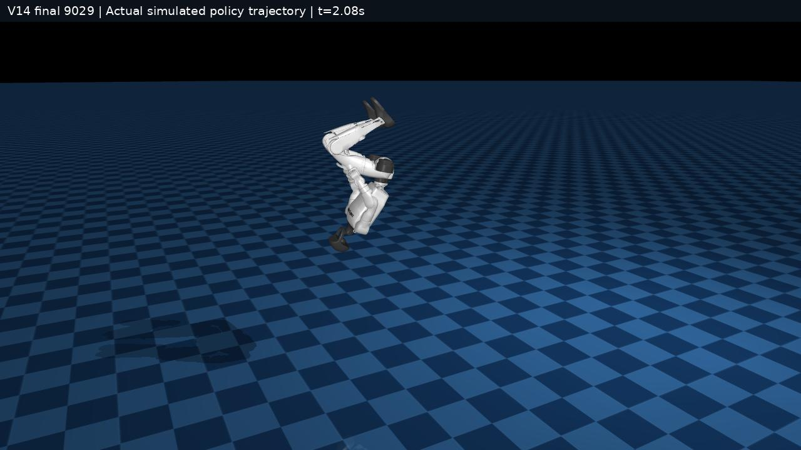
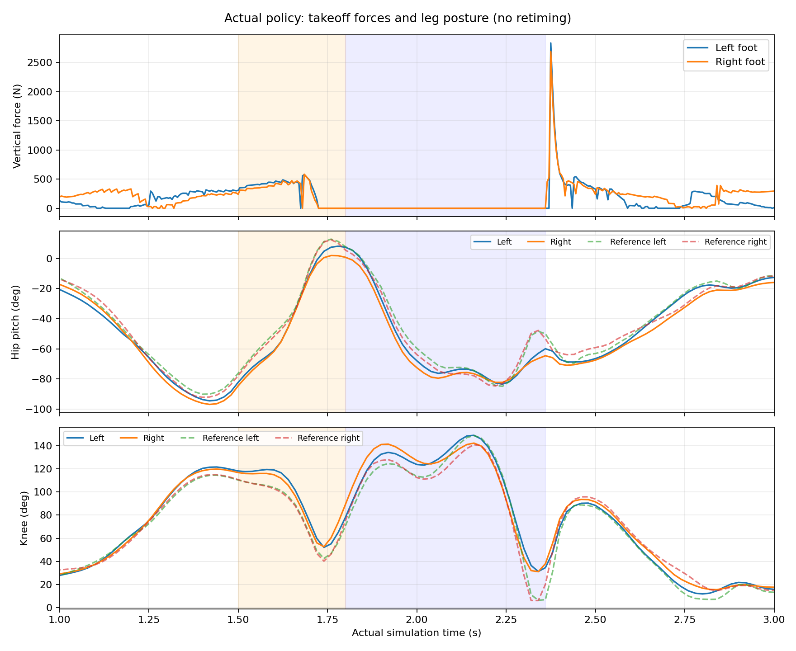

# 单张 RTX 5090：SuperMimic G1 后空翻复现

基于 [zita-ch/supermimic_vibed](https://github.com/zita-ch/supermimic_vibed) 完整训练实现，在**单张 RTX 5090 32 GB** 上对一个 G1 后空翻动作从随机初始化训练。没有使用外部预训练策略。这里提供固定版本源码、环境记录、数据获取与校验脚本、训练入口、物理接触力校验、实际策略评测和视频。

**当前结论：分腿、侧扭及左右腿不对称显著改善，完整后翻和落地保持通过；严格验收仍失败。** 最终检查点为 **9029**，落地时存在1帧右小腿／踝部几何穿透，不能表述为完全成功或完整复现论文全部实验。

[](media/v14_blue_checker.mp4)

- [蓝色棋盘格实际策略视频](media/v14_blue_checker.mp4)
- [实际策略正面／侧面视频](media/v14_side_front.mp4)
- [参考动作、V12、V13、V14同步对比](media/v12_v13_v14_comparison.mp4)
- [完整安装与复现步骤](docs/REPRODUCE.zh-CN.md) · [评测与接触力说明](docs/EVALUATION.zh-CN.md) · [方法差异与版本](docs/METHOD_AND_PROVENANCE.md)

视频使用真实物理求解保存的状态渲染，并非参考动作驱动的动画。棋盘格版本仅改变显示材质、灯光和相机。对比视频最左列单独标注了运动学参考；所有列使用同一时间轴，不对齐/重定时动作，不以中间更好权重替换最终权重。

## 结果

| 指标 | V12最终17900 | V13最终19900 | V14最终9029 |
|---|---:|---:|---:|
| 腾空最大脚踝间距 | 1.1562 m | 1.0961 m | **0.3759 m** |
| 腾空髋膝姿态RMSE | 34.62° | 37.17° | **7.17°** |
| 旋转轴偏斜 | 19.59° | 24.69° | **7.74°** |
| 起跳超出参考的左右腿不对称RMSE | 40.29° | 41.58° | **4.70°** |
| 固定腾空窗口不对称RMSE | 41.35° | 48.33° | **4.51°** |
| 几何离地时间差 | 0.16 s | 0.18 s | **0.00 s** |
| 总后翻／腾空旋转角度（绝对值） | 353.8°／248.1° | 354.4°／249.9° | **360.2°／275.1°** |
| 非脚部几何触地帧 | 0 | 2 | **1** |
| 额外保持5秒、末2秒稳定性检查 | 通过 | 未通过 | **通过** |
| 严格验收 | 未通过 | 未通过 | **未通过** |

参考最大脚踝间距约0.3948 m。发布前独立复评得到近似姿态指标、0帧几何非脚接触并通过；原始结果仍保留1帧失败。这表明落地接触存在重复运行波动，不能宣称稳健通过，详见[复评记录](results/v14/independent_packaging_evaluation.json)。

V14原生骨盆奖励均值0.9290，仅用于本实现，不能与V12/V13躯干奖励数值等同。V12/V13使用另一机器人资产且开启自碰撞，V14沿用参考实现关闭自碰撞，**该跨版本对比不能证明某个单独改动的因果效果**。

V14在固定起跳窗口1.5–1.8 s的左右竖直冲量为90.96／81.71 N·s，`abs(L-R)/(abs(L)+abs(R))=5.36%`；峰值577.32／583.31 N。200 Hz记录中两脚于1.725 s同时持续离地。准备阶段受力仍不完全对称。



### 训练成本与复现范围

- 单张RTX 5090，训练进程显存约16.0 GiB（nvidia-smi读数16412 MiB）。
- 随机seed137；4096环境、2048世界模型batch、4096策略batch；500次世界模型预热。
- 策略训练上限90分钟；本次总训练墙钟约93.1分钟，评测和视频另计。
- 最终9029次总迭代，包含8529次策略更新；速度约1.55–1.60迭代/秒。
- 只有一个seed和一个动作，不代表泛化、实机部署或论文大规模动作库复现。GPU执行不保证逐位确定；墙钟上限也会导致不同机器的最终迭代数不同。

## 快速入口

完整步骤见 [复现文档](docs/REPRODUCE.zh-CN.md)。已有Linux NVIDIA环境时，核心流程如下：

```bash
# 在仓库根目录执行；先按文档安装系统依赖和uv。
python3 scripts/setup.py
export CUDA_VISIBLE_DEVICES=GPU-你的目标显卡UUID
export MUJOCO_EGL_DEVICE_ID=该显卡的物理序号
.runtime/.venv/bin/python scripts/prepare_data.py
python3 scripts/build_baseline_adapter.py
.runtime/.venv/bin/python scripts/probe_reference_env.py
.runtime/.venv/bin/python scripts/run_reference_training.py smoke
.runtime/.venv/bin/python scripts/run_reference_training.py main
```

正式入口拒绝覆盖已有run；接触力校验和容量smoke必须通过。正常结束自动评测最后的`last.pt`，保存200 Hz力记录、受力图和棋盘格视频。`smoke`仅测试容量，不能当成训练成果。

可选最终权重由本仓库Release提供，**只用于查看/复评本次成果**；从零复现的主训练入口不加载它。大权重不放进Git历史。

## 目录与来源

- `third_party/supermimic_vibed/`：固定提交`a1508d42...`的算法源码与资产转换工具，保留原作者版权；这里只保留所需源码/文档，不混入上游其他实验视频。
- `scripts/`：便携路径配置、环境/数据准备、训练预算适配、接触力校验、评测和渲染。
- `environment/`：实际环境冻结记录、IsaacLab锁文件导出、资产与轮子校验值。
- `patches/training_adapter.diff`：实际训练对上游`train.py`的差异。
- `results/v14/`：原始最终指标、日志、校验与接触审计记录（机器路径已脱敏）。
- `docs/`：逐步复现、指标定义、差异、归因限制与许可证说明。

方法参考：[SuperMimic论文](https://arxiv.org/abs/2610.28480)。本项目是基于第三方实现的单动作复现实验，不是论文官方代码。上游实现、机器人资产和动作来源须分别署名，详见[来源与许可证](docs/METHOD_AND_PROVENANCE.md)。
